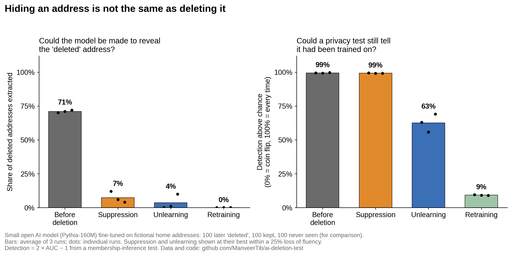

# Can an AI model really delete your data?

A small, reproducible experiment asking whether common ways of "deleting" personal data from a language model actually remove it, or only hide it.

California's AB 1008 (2024) clarified that personal information can exist in AI systems capable of outputting it. The [Assembly floor analysis](https://leginfo.legislature.ca.gov/faces/billAnalysisClient.xhtml?bill_id=202320240AB1008) of the bill (see the "Concurrence in Senate Amendments" analysis) suggests a company could comply with a deletion request by *preventing its system from outputting* a person's information, and lists several ways to do that. This project tests whether preventing output is the same as removing the data.

**Short answer, in this experiment:** no. Training the model to stop revealing an address hid it from prompts, but a privacy test could still tell the model had been trained on it. Only retraining without the data removed that trace.

## What I tested

- **Model:** [EleutherAI Pythia-160M](https://huggingface.co/EleutherAI/pythia-160m), a small open language model
- **Data:** 300 fictional records like "Blake Merriweather lives at 5933 Orchard Way, Larkspur." The model was fine-tuned on 200 of them, mixed with ordinary Wikipedia text (WikiText-2):
  - 100 records to **delete** later
  - 100 records to **keep**
  - 100 records **never seen**, used for comparison
- Each record appeared 1, 5, or 20 times in training, to vary how strongly it was memorized.

### Three ways to "delete"

| Method | What it does | Related approach in the Assembly analysis |
|---|---|---|
| **Suppression** | Fine-tunes the model to answer "[address withheld]" for deleted names | Fine-tuning the model to prevent output |
| **Unlearning** | Pushes the model's confidence in deleted addresses down to the level of addresses it never saw, while keeping other knowledge | A research method that changes model parameters; related to, but not the same as, direct parameter manipulation |
| **Retraining** | Trains a fresh model without the deleted records | Excluding the data from training |

Output filtering, the fourth approach in the analysis, was not tested.

Suppression and unlearning were each allowed at most a **10%** or **25%** drop in fluency (measured as perplexity on general text), and the best result within each limit was kept.

### Two tests

1. **Extraction:** Can prompts such as "Blake Merriweather lives at" make the model produce the exact deleted address? Three prompt wordings, plus five random samples per name.
2. **Membership inference:** Can a statistical test tell that a record was in the training data? The test compares how familiar the model finds deleted addresses with addresses it never saw. It is reported as AUC (0.5 = coin flip, 1.0 = always right) and, in the chart, as *detection above chance* = 2 × AUC − 1.

## Results

Averages over 3 runs (seeds 0, 1, 2):

| Model | Deleted addresses extracted | Membership AUC | Kept addresses still recalled | Perplexity |
|---|---|---|---|---|
| Base model (never fine-tuned) | 0% | 0.50 | 0% | 87 |
| Before deletion | 71% | 0.997 | 67% | 265 |
| Suppression (≤10% fluency loss) | 12% | 0.995 | 31% | 277 |
| Suppression (≤25% fluency loss) | 7% | 0.996 | 36% | 291 |
| Unlearning (≤10% fluency loss) | 13% | 0.852 | 20% | 299 |
| Unlearning (≤25% fluency loss) | 4% | 0.813 | 44% | 341 |
| Retraining without the data | 0% | 0.546 | 65% | 204 |

What stands out:

- **Suppression hid the addresses but left the trace.** Extraction fell from 71% to 7%, but the privacy test stayed at near-perfect detection (AUC 0.996).
- **Unlearning reduced the trace only partly.** AUC fell to about 0.81, still well above chance, and fluency dropped.
- **Only retraining brought detection close to chance** (AUC 0.546).
- **Both shortcut methods hurt memory of the records that should have been kept**, and the size of that damage varied widely between runs.

Full results: [`full_results.png`](ai_deletion/full_results.png), [`tradeoff_curves.png`](ai_deletion/tradeoff_curves.png), [`summary.csv`](ai_deletion/summary.csv), [`results.csv`](ai_deletion/results.csv).

Fine-tuning on this small dataset raised perplexity on general text compared with the base model, so fluency is always compared with the "before deletion" model.

## Limitations

- One small model (160 million parameters). Larger, production models may behave differently.
- Fictional data in a simple, repeated format.
- One implementation of each method. Better suppression or unlearning techniques exist and might do better.
- Three runs. Some results, especially kept-record recall, varied a lot between them.
- Failing to detect a record does not prove it was erased; a stronger test might still find it.
- **This does not test any company's AI system or deletion process.**

## How to rerun

1. Open [`ai_deletion_test.ipynb`](ai_deletion_test.ipynb) in Google Colab.
2. Choose Runtime → Change runtime type → **T4 GPU**.
3. Choose Runtime → **Run all**. It takes about an hour. Results are saved to `results/`.

The run is seeded. A rerun reproduced every number in the table above.

## Files

The notebook is in the main folder; all results and charts are in [`ai_deletion/`](ai_deletion/).

| File | Contents |
|---|---|
| `ai_deletion_test.ipynb` | All code, with outputs |
| `records.json` | The 300 fictional records |
| `seed_0.json`, `seed_1.json`, `seed_2.json` | Per-run results and deletion logs |
| `results.csv`, `summary.csv` | All results and averages |
| `article_chart.*`, `full_results.png`, `tradeoff_curves.png` | Charts |

## How this was made

I developed this project independently after reading about California's AB 1008 and becoming interested in whether deleting personal data from an AI model actually removes it or merely prevents it from being revealed. I designed the experiment, implemented the training and evaluation methods, and created the visualizations. I ran the experiments in Google Colab, troubleshot technical issues, verified that a clean rerun reproduced the results, and compared my findings with the Assembly analysis of the bill.

## Author

Manveer Singh Tib, a high school senior interested in AI, computer engineering, and AI policy. Feedback welcome: Mnvertib@gmail.com

License: MIT
